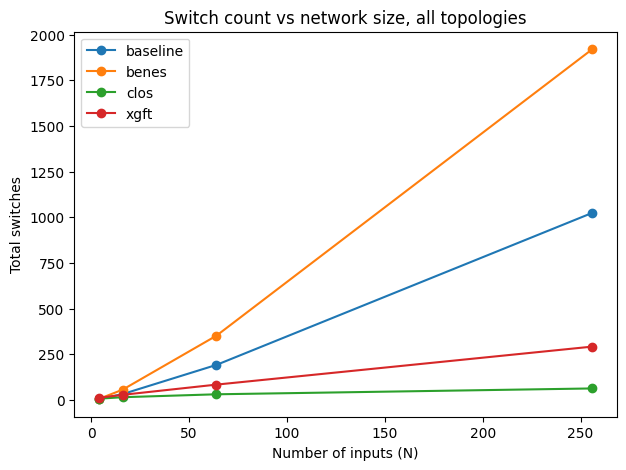
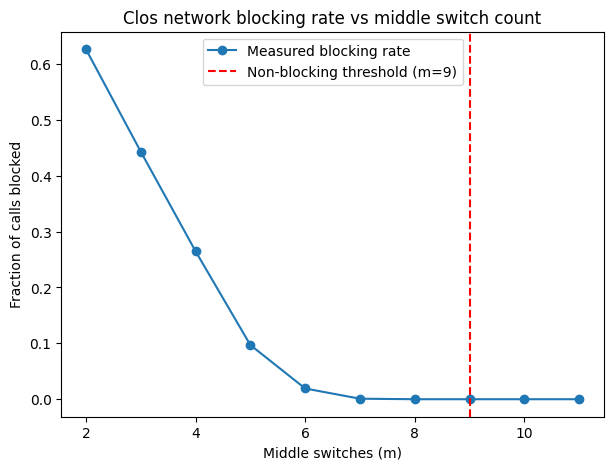

# Simulating Multistage Interconnection Networks

**Python-based modeling, routing, and performance evaluation of four interconnection network architectures used in parallel computing systems.**

## Project Overview

This project investigates how different multistage interconnection networks connect processors and memory components in parallel computer architectures.

Four network topologies are implemented and compared:

- **Baseline Network:** A multistage switching network using destination-bit-based routing.
- **Beneš Network:** A rearrangeably non-blocking network with permutation routing using the Looping Algorithm.
- **Clos Network:** A three-stage switching architecture with multiple routing alternatives and configurable middle switches.
- **XGFT Fat-Tree:** A generalized fat-tree architecture with hierarchical connectivity and redundant paths.

The project includes network construction, routing algorithms, correctness checks, visualization, and performance evaluation.

## Key Features

- Construction and visualization of four network architectures.
- Implementation of topology-specific routing algorithms.
- Verification of routing behavior through automated checks.
- Simulation of Clos network blocking under randomized traffic.
- Comparison of switch and connection counts as network size increases.
- Interactive HTML demonstration with animated network paths.

## Interactive Demonstration

Open `network_demo.html` in a browser to explore the included visualizations and routing demonstrations without installing Python.

## Performance Analysis

The experiments compare network scalability using switch counts and connection counts, and investigate Clos network blocking rates as the number of middle switches changes.





The experiments investigate the theoretical non-blocking condition for a three-stage Clos network:

**m ≥ 2n − 1**

where `m` is the number of middle-stage switches and `n` is the number of input ports per first-stage switch.

The project includes a report explaining the architecture, methodology, experiments, and findings.

## Technologies Used

| Technology | Purpose |
| --- | --- |
| Python | Simulation and routing algorithms |
| NetworkX | Graph construction and topology analysis |
| Matplotlib | Visualization and performance plots |
| HTML / JavaScript | Interactive browser demonstration |
| LaTeX | Technical project report |

## Skills Demonstrated

- **Computer Architecture:** Modeling multistage interconnection networks.
- **Graph Algorithms:** Constructing topologies and implementing routing logic.
- **Simulation:** Running network experiments and randomized traffic tests.
- **Performance Evaluation:** Analyzing scalability, blocking rates, and architecture trade-offs.
- **Software Testing:** Implementing checks for routing behavior.
- **Data Visualization:** Presenting results through graphs and interactive demonstrations.

## Repository Structure

| Path | Description |
| --- | --- |
| `networks/` | Network topology implementations |
| `routing/` | Routing algorithms and blocking logic |
| `tests/` | Routing and correctness checks |
| `pictures/` | Network diagrams and analysis plots |
| `run_all.py` | Runs the complete project workflow |
| `run_demo.py` | Demonstrates routing across architectures |
| `scaling_analysis.py` | Analyzes network scalability |
| `blocking_analysis.py` | Simulates Clos network blocking |
| `network_demo.html` | Interactive network demonstration |
| `report/` | Research report and bibliography |

## Installation and Usage

Install the dependencies:

```bash
python3 -m pip install networkx matplotlib
```

Run the complete workflow:

```bash
python3 run_all.py
```

Alternatively, open `network_demo.html` directly in your browser to explore the existing demonstration.

## Limitations and Future Work

- The experiments use simulated network configurations rather than physical hardware.
- Routing strategies are primarily deterministic and do not adapt dynamically to network congestion.
- Blocking analysis currently focuses on Clos networks.
- Further work could investigate adaptive routing and performance under real parallel-computing workloads.

## Author

**Ferola Hima**

MSc Computer Science — Sapienza University of Rome

Advanced Architectures course project
